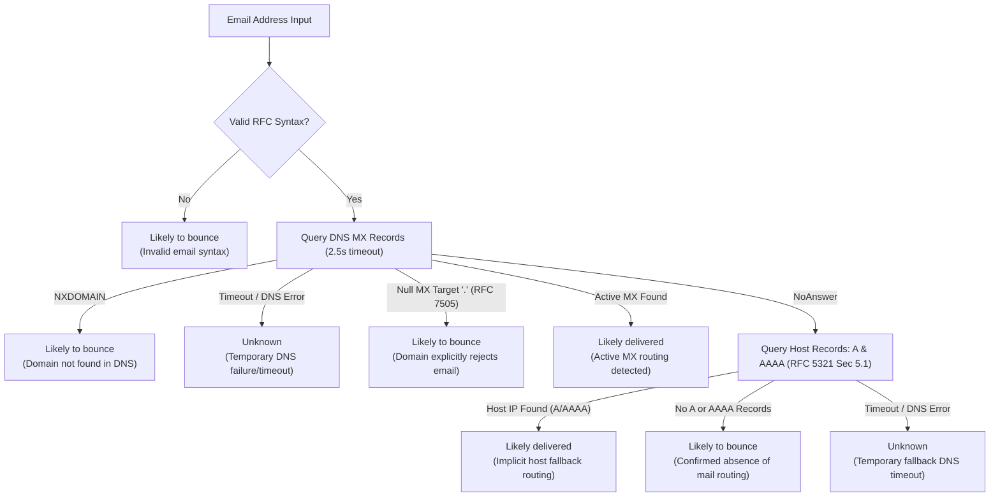

# EmailCheck PRO | High-Throughput Email Intelligence & DNS Verification

[](https://www.python.org/)
[](https://flask.palletsprojects.com/)
[](LICENSE)
[]()
[](https://emailcheck-5n2a.onrender.com/)

> **ShieldNex Aerospace Software Development Internship Final Submission**  
> *Evidence-based email syntax validation and DNS mail-routing assessment. Deterministically classifies email addresses into **Likely delivered**, **Likely to bounce**, and **Unknown** without invasive SMTP probing or privacy compromises. Supports high-throughput batching (100 default, 500 advanced limit) with bounded concurrency and thread-safe DNS caching.*

- **Live Application:** [https://emailcheck-5n2a.onrender.com/](https://emailcheck-5n2a.onrender.com/)
- **Source Repository:** [https://github.com/vivek-25bce8656/EmailCheck](https://github.com/vivek-25bce8656/EmailCheck)

---

## 1. Project Overview & Purpose

**EmailCheck PRO** is a production-ready, evidence-based email syntax and DNS mail-routing assessment platform built with Python, Flask, and `dnspython`.

The application accepts batches of email addresses (formatted one per line, comma-separated, or semicolon-separated) and evaluates them against RFC standards and observable DNS records. Each address is deterministically classified into one of three user-facing categories:

1. **Likely delivered**
2. **Likely to bounce**
3. **Unknown**

### Delivery Disclaimer
These classifications represent an **assessment of domain routing capability and syntax validity**, not an absolute guarantee of individual mailbox existence. EmailCheck does not claim that DNS records prove an individual mailbox exists, nor does it send test emails or execute invasive SMTP probing.

---

## 2. Core Features & Technology Stack

- **Backend Architecture:** Python 3.10+ / Flask / `dnspython` / Gunicorn (WSGI)
- **High-Throughput Batch Processing:**
  - **Default Limit:** 100 unique email addresses per batch.
  - **Optional Advanced Limit:** 500 unique email addresses per batch (selectable in UI).
  - **Fixed Upper Bound:** Strict server-side ceiling at 500 addresses prevents parameter tampering or denial-of-service.
- **Bounded Concurrency & DNS Optimization:**
  - Addresses within a batch are grouped by domain to eliminate redundant lookups.
  - Uncached domains are resolved concurrently via a bounded worker pool (`ThreadPoolExecutor`), maintaining sub-second to low-second response times.
  - Thread-safe bounded in-memory cache (capacity: 2,500 entries) with TTL prevents duplicate network round-trips.
- **Frontend Architecture:** Accessible HTML5, Vanilla CSS3 with CSS Custom Properties, and Vanilla JavaScript (Zero external JavaScript dependencies or CSS frameworks).
- **Multi-Separator Input Support:** Accepts email addresses separated by newlines, commas, or semicolons, with automatic client-side and server-side whitespace trimming and duplicate filtering.
- **Three-Tier Evidence-Based Classification:** Deterministic categorization into `Likely delivered`, `Likely to bounce`, and `Unknown`.
- **Granular Diagnostic Reporting:** Real-time visibility into *Routing Configured*, *No Routing Detected*, *Domain Not Found (NXDOMAIN)*, *RFC 7505 Null MX*, *Invalid Format*, and *Unable to Verify*.
- **Inconclusive Retry Mechanism:** Dedicated one-click action to re-evaluate inconclusive (Unknown) addresses without losing the original workbench input.
- **RFC Syntax Validation:** Comprehensive RFC 5321 and RFC 5322 parsing covering address length, local-part format, dot-atom rules, sub-addressing (`+tags`), and Internationalized Domain Names (IDN/Punycode).
- **Authoritative Mail Exchange (MX) Analysis:** Queries authoritative MX records, ranks exchangers by priority, and identifies primary mail gateways.
- **RFC 7505 Null MX Detection:** Explicitly identifies domains that publish target `.` records declaring no email acceptance, ensuring implicit fallback routing is not erroneously applied.
- **RFC 5321 Section 5.1 Host Fallback:** Checks IPv4 (A) and IPv6 (AAAA) records when no MX records are published.
- **Spreadsheet Formula Injection Defense:** Neutralizes CSV injection vulnerabilities (`=`, `+`, `-`, `@`, `\t`, `\r`) with leading apostrophe shielding across both client-side and server-side exports.
- **Privacy & Security First:** In-memory request processing, zero application-level address persistence, and strict HTTP security headers (CSP, `X-Frame-Options: DENY`, `X-Content-Type-Options: nosniff`, `Referrer-Policy`).

---

## 3. Batch Limits & High-Throughput Processing Architecture

### Batch Limit Configuration
EmailCheck supports two verified batch processing tiers:
1. **Default Maximum (100 unique addresses):** Intended for rapid routine list assessment.
2. **Advanced Maximum (500 unique addresses):** Intended for larger campaign verification and analytical audits.

The batch size limit is selectable directly in the user interface via a segmented control and is enforced consistently on both frontend and backend:

```
[ 100 Addresses (Default) ]   [ 500 Addresses (Advanced) ]
```

### High-Throughput Concurrency Model
To safely process up to 500 addresses per batch within cloud deployment execution limits:
1. **Pre-Evaluation Syntax Filtering:** All addresses are validated for syntax in memory (sub-millisecond). Syntax errors are classified immediately as `Likely to bounce` without consuming DNS resources.
2. **Domain Grouping (Deduplication):** Valid addresses are grouped by unique domain. If 200 addresses in a batch share `@company.com`, only **one** DNS resolution is executed for `company.com`.
3. **Thread-Safe DNS Cache Check:** Cached domain entries with valid TTL are retrieved instantly under a lock, bypassing network queries.
4. **Bounded Worker Pool:** Uncached domains are resolved in parallel using `concurrent.futures.ThreadPoolExecutor(max_workers=16)`. The pool is bounded to prevent socket exhaustion and rate-limiting from authoritative DNS servers.
5. **Deterministic Order Reconstruction:** Results are mapped back to their original submission indices, ensuring 100% preservation of input order.

---

## 4. How Email Syntax is Checked

Email addresses are inspected using RFC 5321 and RFC 5322 specifications:

1. **Length Constraints:**
   - Total address length must not exceed **254 characters** (RFC 5321 Section 4.5.3.1.3).
   - Local part (before `@`) must not exceed **64 characters** (RFC 5321 Section 4.5.3.1.1).
   - Domain part must not exceed **253 characters**, with each label limited to **63 characters** (RFC 1035).
2. **Delimiter Rules:**
   - Exactly one `@` delimiter is permitted.
   - Internal whitespace is strictly rejected.
3. **Local Part Formatting:**
   - Must conform to dot-atom specifications (`[A-Za-z0-9!#$%&'*+/=?^_`{|}~-]+`).
   - Period placement: Cannot begin with a period, end with a period, or contain consecutive periods (`..`).
   - Plus-addressing / sub-addressing (`user+tag@domain.com`) is recognized as valid syntax.
   - Local part must be ASCII-formatted unless standard SMTPUTF8 internationalization is explicitly configured.
4. **Domain Portion & IDN Handling:**
   - Domain must contain at least a host name and a valid Top-Level Domain (TLD). Purely numeric TLDs and single-label domains are rejected.
   - Domain labels cannot start or end with a hyphen.
   - Internationalized Domain Names (IDN) with Unicode characters are safely normalized to ASCII Punycode via Python's `idna` codec (e.g. `user@münchen.de` &rarr; `user@xn--mnchen-3ya.de`).
   - IP literal domains (`[192.168.1.1]`) are flagged as unsupported for public mail exchange.

Any address that fails syntax validation is classified as **Likely to bounce** with a specific technical explanation.

---

## 5. DNS and Mail-Routing Assessment

For syntactically valid addresses, domain mail routing is evaluated in strict adherence to Internet standards:



### MX Record Resolution
The domain's DNS is queried for `MX` records using a 2.5-second timeout. If active mail exchangers exist, they are sorted by numerical preference, and the primary mail exchanger is reported.

### RFC 7505 Null MX Detection
RFC 7505 ("A 'Null MX' No-Service Resource Record for Domains That Accept No Mail") defines an explicit mechanism for domain owners to declare that a domain does not accept email. A Null MX record consists of an MX record with preference 0 and target `.` (the DNS root).
- When a Null MX record is detected, EmailCheck immediately recognizes that the domain explicitly rejects all email.
- Under RFC 7505, **implicit A/AAAA fallback routing does not apply**.
- The address is classified as **Likely to bounce**.

### RFC 5321 Section 5.1 Fallback Routing (A and AAAA Records)
Under RFC 5321 Section 5.1, when a domain exists but publishes no MX records (and no Null MX record), mail transfer agents fall back to the domain's address records:
1. Query IPv4 `A` records.
2. If no IPv4 address exists, query IPv6 `AAAA` records.
3. If valid host IP records exist, the address is classified as **Likely delivered** via implicit fallback routing.

### Distinguishing Absence of Routing from Temporary DNS Failures
A critical requirement of EmailCheck is never treating network disruptions as delivery failures:
- **Confirmed Absence of Mail Routing:** Domain exists in DNS (`NoAnswer` on MX), but has neither `A` nor `AAAA` address records. Mail transfer agents have no network destination to route messages. &rarr; **Likely to bounce**.
- **Temporary Lookup Failure or Timeout:** DNS query times out or returns a resolver exception (`SERVFAIL`, network timeout, connection dropped). &rarr; **Unknown**. A timeout is **never** assumed to be a bounce.

---

## 6. Exact Classification Matrix

| Classification | Technical Criteria & Evidence | User-Facing Explanation | Limitations & Disclaimers |
| :--- | :--- | :--- | :--- |
| **Likely delivered** | Address has valid RFC syntax AND domain has verified mail routing:<br/>&bull; One or more active MX records, OR<br/>&bull; Active IPv4 (A) or IPv6 (AAAA) host fallback records under RFC 5321. | "Domain publishes active mail exchange (MX) server(s) [or host fallback IP]. Mail routing is configured at the domain level." | **Assessment, not a guarantee.** DNS confirms domain mail-routing infrastructure; individual recipient mailbox existence cannot be confirmed without sending an email. |
| **Likely to bounce** | Confirmed delivery failure condition detected:<br/>&bull; Malformed email syntax (RFC violation)<br/>&bull; Domain does not exist in DNS (`NXDOMAIN`)<br/>&bull; RFC 7505 Null MX record (`.` target)<br/>&bull; Confirmed absence of both MX and A/AAAA routing records. | "Invalid email syntax" OR "Domain does not exist in DNS (NXDOMAIN)" OR "Domain publishes a Null MX record (RFC 7505)" OR "Domain has no MX or fallback host records." | Address or domain configuration will prevent message delivery; mail transfer agents will reject or bounce the message. |
| **Unknown** | Inconclusive network evidence:<br/>&bull; DNS query timed out during MX or A/AAAA lookup<br/>&bull; Resolver exception or temporary network connectivity failure<br/>&bull; Unresponsive authoritative nameservers. | "DNS lookup timed out while querying mail exchange records" OR "DNS check failed due to a temporary resolution or network error." | Outcome cannot be reliably determined from available network evidence. Not treated as proof that the domain cannot receive email. |

---

## 7. What the Application Can and Cannot Establish

### What EmailCheck CAN Establish:
- Whether an email address complies with RFC 5321 and RFC 5322 syntax specifications.
- Whether the domain exists in global DNS (`NXDOMAIN` vs. active delegation).
- Whether the domain publishes authoritative MX records, including server priorities and hostnames.
- Whether the domain explicitly declines email acceptance via an RFC 7505 Null MX record.
- Whether the domain supports implicit mail routing via IPv4 (A) or IPv6 (AAAA) host records under RFC 5321 Section 5.1.
- Whether DNS queries succeed or experience timeouts/transient errors.

### What EmailCheck CANNOT Establish (Why DNS Does Not Prove Mailbox Existence):
- **DNS records operate at the domain level, not the mailbox level.** A domain such as `google.com` or `microsoft.com` publishes valid MX records for the entire organization. DNS has no visibility into whether an individual mailbox (e.g. `definitely-fake-user-1234567@google.com`) actually exists.
- **Mailbox existence is managed internally** by the recipient mail server's directory (LDAP, Active Directory, mail database).
- **True deliverability depends on dynamic runtime factors:**
  - Recipient mailbox existence and active status.
  - Mailbox storage quotas (over-quota mailboxes bounce).
  - Receiving server spam filters, SPF/DKIM/DMARC policies, and greylisting.
  - Catch-all configurations (accepting all addresses regardless of existence).
- **Zero email transmission:** EmailCheck does not send emails to test addresses.

---

## 8. Deployment Architecture & Hosting Environment Constraints

EmailCheck is deployed as a Web Service on Render:
- **Build Command:** `pip install -r requirements.txt`
- **Start Command:** `gunicorn app:app`
- **Python Version:** Python 3.12+
- **Live URL:** [https://emailcheck-5n2a.onrender.com/](https://emailcheck-5n2a.onrender.com/)

### Cloud Network Restrictions (Outbound Port 25 Blocked)
In production cloud environments (including Render, AWS, Google Cloud, DigitalOcean, and Heroku), outbound connections on **TCP port 25 are strictly blocked by cloud network firewall policies** to prevent spam relaying and abuse.
- Consequently, direct SMTP mailbox socket probes (connecting to port 25 to send `HELO`, `MAIL FROM`, and `RCPT TO` commands) cannot be performed in cloud environments.
- EmailCheck is purposefully architected to operate entirely via DNS lookups over UDP/TCP port 53, which function reliably in cloud hosting environments.

### Render Free-Tier Cold Starts & HTTP 503 Behavior
On Render's free tier, Web Services automatically spin down to 0 instances after 15 minutes of inactivity.
- When an incoming request arrives while the service is dormant, Render's edge router initiates a cold boot of the container.
- During container startup or during redeployments, requests can experience startup latency or return a transient **HTTP 503 Service Unavailable** while Gunicorn binds to `$PORT`.
- Once booted, the application serves requests normally with `HTTP 200 OK` and `/health` returns `{"service":"EmailCheck","status":"healthy"}`.

---

## 9. Local Installation & Execution

### Prerequisites
- Python 3.10, 3.11, or 3.12
- Git

### 1. Clone the Repository
```bash
git clone https://github.com/vivek-25bce8656/EmailCheck.git
cd EmailCheck
```

### 2. Create and Activate a Virtual Environment

**On Windows (PowerShell):**
```powershell
python -m venv .venv
.\.venv\Scripts\Activate.ps1
```

**On macOS / Linux:**
```bash
python3 -m venv .venv
source .venv/bin/activate
```

### 3. Install Dependencies
```bash
pip install -r requirements.txt
```

### 4. Run the Application Locally
```bash
python app.py
```
Open your browser and navigate to `http://127.0.0.1:5000`.

---

## 10. Automated Testing & Verification

The automated test suite uses **100% mocked DNS responses** (`unittest.mock`), ensuring fast, deterministic, reproducible execution without external network dependencies.

### Running the Test Suite
```bash
python -m unittest test_app.py -v
```

### Measuring Statement Coverage
```bash
python -m coverage run -m unittest test_app.py
python -m coverage report
```

### Verified Test Results
- **Test Count:** **44 automated unit tests**
- **Test Status:** **44 passing (100% success)**
- **Statement Coverage:** **96% total coverage** across 1,000 statements

```
Name               Stmts   Miss  Cover
--------------------------------------
app.py               147      9    94%
email_checker.py     299     26    91%
test_app.py          554      4    99%
--------------------------------------
TOTAL               1000     39    96%
```

### Test Suite Coverage Breakdown:
1. **Homepage & Navigation:** Rendering, status code 200, branding, and sample data loading.
2. **Security Headers:** Enforcement of CSP, `X-Frame-Options: DENY`, `X-Content-Type-Options: nosniff`, and `Referrer-Policy`.
3. **Valid RFC Syntax:** Standard addresses, dots, hyphens, sub-addressing (+tags), and multi-level domains.
4. **Invalid Syntax Detection:** Missing `@`, multiple `@`, whitespace, leading/trailing periods, consecutive periods, invalid TLDs, and IP literals.
5. **Length Constraints:** RFC 5321 limits (local-part <= 64 chars, total address <= 254 chars).
6. **IDN / Punycode Normalization:** Automatic conversion of non-ASCII internationalized domain names.
7. **Input Normalization & Deduplication:** Server-side deduplication preserving insertion order, handling leading/trailing whitespace.
8. **Input Separator Parsing:** Support for comma-separated, semicolon-separated, and newline-separated inputs.
9. **Default 100 Batch Limit:** Accepts 100 unique addresses, rejects 101.
10. **Optional 500 Batch Limit:** Accepts 500 unique addresses when selected, rejects 501.
11. **Batch Limit Tampering Protection:** Verifies that manipulated limits beyond 500 are capped at 500.
12. **Payload Size Guardrails:** Enforcing maximum 150,000 character payload limits.
13. **Authoritative MX Resolution:** Mocked MX priority ranking and primary server extraction.
14. **RFC 7505 Null MX Handling:** Validating that domains with target `.` are classified as `Likely to bounce` and do not trigger fallback queries.
15. **RFC 5321 Fallback Routing:** Verifying implicit mail routing via IPv4 (A) and IPv6 (AAAA) host records.
16. **Confirmed Absence of Mail Routing:** Verifying `Likely to bounce` when domain exists but has no MX, A, or AAAA records.
17. **DNS Timeouts & Resolver Failures:** Ensuring transient failures are classified as `Unknown` and never misclassified as bounces.
18. **Three-Tier Classification Mapping:** Validating that every scenario maps strictly to `Likely delivered`, `Likely to bounce`, or `Unknown`.
19. **Delivery Disclaimers:** Ensuring `is_deliverable_claim` is strictly `False` and limitation notices are present.
20. **Mixed-Category Batch Processing:** Testing batches containing delivered, bounce, and unknown addresses simultaneously.
21. **Domain Insights Aggregation:** Independent domain-level intelligence decoupled from individual address syntax errors.
22. **Thread-Safe Bounded Caching:** Verifying cache hits and LRU eviction at maximum capacity (2,500 domains).
23. **CSV Formula Injection Shielding:** Validating that `=SUM(...)`, `@evil.com`, `+cmd`, `-cmd`, `\t`, `\r` are escaped with leading apostrophes.
24. **CSV Export Truncation & Limits:** Proper CSV export truncation at default 100 limit and advanced 500 limit.
25. **Batch Domain Deduplication:** Verifying that 25 addresses with the same domain trigger only 1 DNS resolution.
26. **Bounded Concurrency & Order Preservation:** Testing `assess_batch` with mixed records and strict order preservation.
27. **500-Address Batch Stress & Accounting:** Verifying that 500 addresses process deterministically with zero omissions.
28. **JSON / AJAX API Response:** Validating progressive enhancement endpoint with structured JSON metrics.
29. **Inconclusive Retry Workflow:** Simulating re-evaluation of inconclusive addresses after network recovery.
30. **Health Check Endpoint:** Verifying `/health` returns JSON status, version 3.0.0, and UTC timestamp.
31. **HTTP Error Handlers:** 400 Bad Request, 404 Not Found, 413 Payload Too Large, and 500 Internal Server Error.

---

## 11. Security, Privacy & Responsible Use

- **Spreadsheet Formula Injection Defense:** All user-controlled fields exported to CSV are protected against formula execution in Microsoft Excel, Google Sheets, and LibreOffice Calc.
- **In-Memory Address Processing:** Submitted email addresses are processed in memory during request execution and are never written to internal databases or persisted to disk.
- **No Spam or Mailbox Probing:** Zero email delivery attempts and zero intrusive network handshakes.

---

## 12. Internship Submission Document Status

Per the submission guidelines, the project workspace was inspected for a separate internship submission PDF or DOCX file:
- **Status:** No PDF or DOCX submission document was present in the workspace root or repository.
- **Working Links Verified:**
  - Live Deployment: `https://emailcheck-5n2a.onrender.com/` (Active, HTTP 200 OK)
  - GitHub Repository: `https://github.com/vivek-25bce8656/EmailCheck` (Active, tracked on `origin/main`)

---

## 13. License

This project is licensed under the [MIT License](LICENSE).
